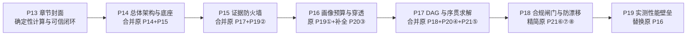

# S3 技术板块（P13–P21）优化方案

**核心结论：将 P13–P21 从 9 页压缩重构为 7 页；合并 3 处重复叙事，删除 P16 常规部署页，新增 1 页实测性能壁垒页，清零 5 处文图错位与低级瑕疵。**

---

## 一、重构后页序与时长（9 页 -> 7 页）

| 新页序 | 原页来源 | 页面主题 | 演讲核心句 | 时长 |
| --- | --- | --- | --- | --- |
| P13 | P13 | 技术架构｜确定性计算底座与可信决策闭环 | 物理隔离 LLM 推理与确定性金融计算 | 10s |
| P14 | P14 + P15 | 分层架构与 SkillHub 底座集成 | 复用问财 9 项 Skill，自研四重上层控制链 | 35s |
| P15 | P17 + P19② | 创新一：来源等价类证据防火墙 | `lineage_id` 去重，双独立源一致才升格为事实 | 45s |
| P16 | P19① + P20③ | 创新二：画像风险预算与组合穿透 | 画像转为硬预算红线，穿透 ETF 与 HHI 刚性卡线 | 40s |
| P17 | P18 + P20④ + P21⑤ | 创新三：有界 DAG 调度与离散序贯求解 | 时间预算并行编排 + `O(log n)` 整手二分再平衡 | 45s |
| P18 | P21⑥⑦⑧ | 创新四：独立合规闸门与状态防漂移 | 双闸门硬拦截 + SHA-256 会话指纹防上下文篡改 | 40s |
| P19 | 替换 P16 | 技术性能壁垒与工程实测 | 3.57ms 确定性求解、0.00 元误差、58 项验证全通过 | 45s |

---

## 二、逐页删改清单

### P13（封面页）
* **删**：错贴的 5 人团队分工备注。
* **改**：副标题改为「物理隔离大模型推理与确定性金融计算，构建可追溯、可复算、可拦截的投顾架构」。

### P14（合并原 P14 + P15）
* **删**：HTML/CSS/JS、Hash 路由、Uvicorn、RapidOCR 等常规栈流水账；原 P15 绿箭头拼接图（右侧 5 项显示 `NEED_INPUT`）。
* **留**：一张四层架构图，明确切分「问财 SkillHub 底座（9 项 Skill + iFinD + LLM 接口）」与「自研控制链（画像 -> 证据 -> 计算 -> 闸门）」。
* **增**：底部 3 枚技术标签（`Decimal 零浮点误差` / `Pydantic 强契约` / `SHA-256 状态指纹`）+ 1 行交付特性（本地离线复现，生产零改契约切 PostgreSQL）。

### P15（合并原 P17 + P19②）
* **删**：原 P17 口语词（“找到来源网站”“去除水军风险”“去除过期消息”）；原 P19② 140 字纯文字块。
* **留**：左中右三段结构（LLM 候选结论 -> 四级证据防火墙 -> 决策资格）。
* **改**：四级防火墙精简为 4 条短句：
  1. **口径校验**：核验主体 / 指标 / 单位 / 期间。
  2. **来源族去重**：按 `lineage_id` 合并转载镜像，同源仅计 1 票。
  3. **双源升格**：$\ge 2$ 独立源一致且无异议方为事实，冲突挂起复核。
  4. **数值接管**：金额、敞口、HHI 禁止 LLM 生成，由确定性规则计算。

### P16（原 P19① + 补全原 P20③）
* **删**：原 P19 纯文字墙；修正正文（5 维/三档）与备注（19 题/8 维/C1–C5）的口径冲突，统一为「完整问卷量化映射为风险等级与三档预算上限」。
* **左栏（画像硬预算）**：3×4 阈值表（保守 20%/30%/25%、平衡 35%/45%/40%、成长 50%/60%/60%）。
* **右栏（补齐组合穿透）**：基金/ETF 底层穿透暴露守恒 + HHI 集中度检验；列真实对照数据：同一 144.55 万元持仓在三档画像下超限项呈单调变化（3 -> 2 -> 1 项）。

### P17（合并原 P18 + P20④ + P21⑤）
* **删**：原 P20 箭头压字的 10 框竖图；原 P20 带 Word 紫色虚线框、未渲染下划线（`C_{t+1}`）和黑色光标的公式截图；原 P18 右侧被裁切的截图。
* **左栏（有界 DAG 调度）**：极简 4 节点横向矢量图 + 3 条核心机制（环路校验拓扑序、无依赖并行、有效时延 $\tau_{\text{eff}} = \min(\tau_{\text{req}}, \tau_{\text{node}}, T_{\text{remain}})$ 及失败级联取消）。
* **右栏（离散序贯再平衡）**：`先卖后买` 现金逐笔递推 + 四重硬约束（整手、最低现金 $\rho V$、递增费用、0.50% 死区）+ 二分查找最大可买手数（$O(\log \bar{n}_i)$）+ 完整未裁切调仓截图。

### P18（精简原 P21，聚焦机制⑥⑦⑧）
* **删**：重复的机制⑤；缩减 60% 文字（613 字 -> 200 字内）；删掉 2 张过小截图。
* **左栏（3 项安全防线）**：
  * **独立双闸门**：`evaluate_decision_gates()` 物理独立于 LLM，输出 `PASS` / `REVIEW_REQUIRED` / `BLOCKED`。
  * **版本会话锁（`session_truth.v1`）**：`revision + SHA-256 + owner_id` 绑定，前提变更触发 `DRIFT_DETECTED`。
  * **记忆受控恢复**：强制同 `owner` 与事实一致性校验，模型排序结果不得自行升格为事实。
* **右栏**：仅放大保留 2 张清晰证据图（HHI 超限拦截 + 会话版本变更重确认）。

### P19（新增：技术性能壁垒与工程实测，替换原 P16）
* **删**：原 P16 运维部署大段文字；含 `Synthetic Balanced ETF` 字样的旧版截图。
* **建**：三栏实测壁垒表（数据全部取自 `docs/submission/system-test-report.md`）：

| 壁垒维度 | 实测数据 | 对比 LLM 套壳代差 | 评审追问口径 |
| --- | --- | --- | --- |
| 计算速度与精度 | 确定性再平衡全链路 100 次 **P95 = 3.574 ms**；`Decimal` 复算现金恒等式误差 **0.00 元** | 零浮点漂移、零估算幻觉、100% 复算一致 | 明确为本地核心求解耗时，不含外部行情与 LLM 延迟 |
| 契约与安全验证 | **58 项**核心检查 100% 通过（15 画像 + 29 计算存储 + 14 HTTP 权限/拒绝） | 缺失真实源时受控返回 HTTP 409，绝不编造演示结论 | 可现场出示 JUnit/JSON 测试证据 |
| 并发与隔离 | 8 线程 100 次重复写幂等落库 **1 条**；跨账户越权 **100% 拦截（401/403）**；100 并发 1,000 次读取 **0 报错** | 多用户无串台、无重复落库、无越权读取 | 坦诚本地单进程读取 P95 6.019s，生产态通过多 Worker + PostgreSQL 扩展 |

---

## 三、演讲前必改的 5 处硬伤

1. **重写全章备注**：清除 P13–P17、P21 错贴的团队分工，清除 P18 备注中暴露的本地路径 `E:\prism\output\...`。
2. **修复 P20 图文错位**：移除 `组合穿透` 标签下错放的 `序贯再平衡` 内容与带光标 Word 截图。
3. **替换 P18 裁切图**：重截完整的 `SELL / BUY / CALCULATED` 标签。
4. **撤下 P16 合成数据图**：删除露出 `ui-template-etf-001 | Synthetic Balanced ETF` 的页面截图。
5. **统一全章状态枚举**：将分散的 `NOTICE`、`REVIEW`、`REVIEW_REQUIRED` 统一为 `PASS` / `REVIEW_REQUIRED` / `BLOCKED`。
