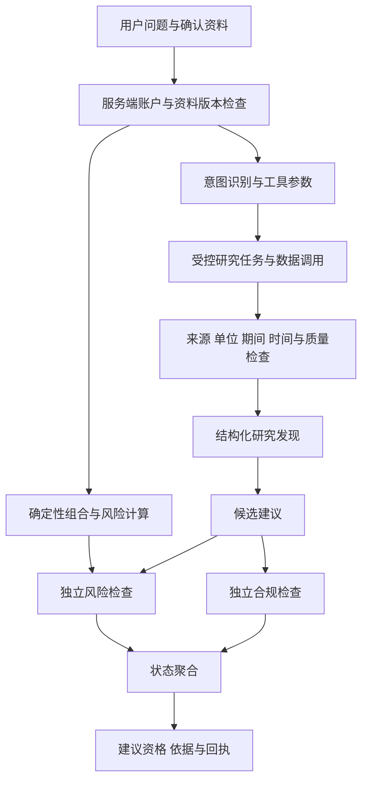

# Prism 技术答辩练习卡

## 第一章 优先练习的问题

### 一、 十二项必答

| 问题 | 口述核心 | 可展示依据 | 需要守住的范围 |
| --- | --- | --- | --- |
| 创新在哪里 | 画像进入约束，研究保留来源，结果能够重算 | 同持仓不同画像、同目标不同交易条件 | 工程创新与算法来源分别说明 |
| LLM 是否计算金额 | 工具执行确定性程序，再生成结构化金融回答 | `agent.py`、再平衡函数 | 路由正确率单独评测 |
| 多 Agent 是否必要 | 按职责组织任务、工具权限与依赖 | DATA、INDICATOR、OBSERVER | 节点数量不等于模型调用数量 |
| 两个来源是否独立 | 使用 `lineage_id` 分组并保留来源关系 | 同源重复与来源冲突检查 | 标签本身无法证明独立性 |
| 数据核验容差多少 | 标量交叉验证精确相等；会话字段有独立容差 | 两个对应模块 | 按模块说明数值规则 |
| 哈希能保证什么 | 检查内容变化与版本一致性 | 输入摘要和回执 | 普通哈希没有独立签名能力 |
| 画像阈值是否科学 | 当前为版本化产品规则 | 分数公式和预算表 | 尚无普遍适用性校准证据 |
| 调仓如何执行 | 目标金额、数量、费用、现金和风险复核 | 逐项计算与调整后结果 | 当前没有实盘撮合 |
| HMM 是否使用未来数据 | 固定训练窗口、前向过滤、时点检查 | `regime_probabilities` | 波动状态不能直接解释为方向 |
| 能否 100 并发三秒 | 100 是单进程活动参数；完整业务需测量 | 准入器与历史 HTTP 报告 | 历史问卷 P95 为 6.019 秒 |
| 服务器现在可用吗 | 应用与 Tunnel 运行，入口要求登录 | 本次只读检查 | `live_ready=false` |
| 部署收益多少 | 按效率、质量、成本、投资结果分别评价 | 运营记录或明确数据占位符 | 当前没有已核验投资收益提升 |

完整问题与口述回答见 [技术答辩问题与回答](technical-defense-questions.md)，共 56 题。

## 第二章 架构讲解

### 一、 结构化建议路径

该图描述结构化建议路径。聊天工具、独立 LIVE 研究和论文算法各有接口及输出条件；展示某条路径时，需要使用对应代码说明其检查范围。

### 二、 五个需要记住的计算

| 项目 | 公式或规则 | 示例 | 解释 |
| --- | --- | --- | --- |
| 画像分数 | `100×Σwᵢ(xᵢ−1)/4` | 五项均为 3 时为 50 分 | 输入先按字段映射为五分制 |
| 资产比例 | `资产市值/明确的总额×100%` | 2 万/10 万=20% | 说明分母是否包含现金 |
| HHI | `Σ百分比²` | 50²+50²=5000 | 说明分组方式与现金处理 |
| 调仓换手率 | `0.5×(买入+卖出)/调整前总资产×100%` | 买卖各 2 万、总额 10 万时为 20% | 本项目再平衡服务口径 |
| 可用性 | `1−不可用时间/总观测时间` | 30 天、99.9% 对应 43.2 分钟 | 示例换算值，需持续观测 |

## 第三章 部署答辩数据填写

### 一、 可直接使用的当前记录

| 项目 | 日期 | 记录 | 适用范围 |
| --- | --- | --- | --- |
| 确定性专项 | 2026-11-16 | 54 项全部通过 | 七个指定测试文件 |
| 服务状态 | 2026-11-16 | 应用与专用 Tunnel 运行 | 单次只读检查 |
| 访问控制 | 2026-11-16 | 公网 303、匿名画像 401 | 所检查入口与接口 |
| 真实能力 | 2026-11-16 | `data_mode=MOCK`、`live_ready=false` | 健康接口摘要 |
| 本地代码 | 本次核查 | `7286164` | 文档对应代码基线 |
| 服务器代码 | 本次核查 | `dea0fa5` | 线上版本，与本地不同 |

### 二、 需要运营记录的数据

| 指标 | 填写内容 | 必须具备的依据 | 无数据时的口述回答 |
| --- | --- | --- | --- |
| 时间节省 | 【人工时间】【系统时间】 | 同类任务、相同人员条件、计时记录 | 已具备复用与自动计算能力，效率比例待测 |
| 有效用户 | 【周期】【去重人数】 | 排除测试账户和探测请求 | 当前为受限验证环境 |
| 问答质量 | 【正确项】【全部项】 | 冻结真实问题、独立复核 | 专项程序检查通过，真实问答准确率待评测 |
| 单次成本 | 【总成本】【合格任务量】 | 实际账单、失败调用计费 | 使用成本构成与公式回答 |
| 长期稳定性 | 【观测时长】【故障时长】 | 连续业务探测 | 当前证据为检查时点的服务状态 |
| 恢复能力 | 【RPO】【RTO】 | 隔离恢复演练 | 备份工具已有，恢复指标待验证 |
| 投资表现 | 【账户】【期间】【基准】【费用】 | 可核查交易或严格模拟记录 | 当前不报告未经核验的收益提升 |

## 第四章 答辩前核查

### 一、 展示条件

1. 确认答辩使用的版本、账户、资料日期与数据模式，检查页面显示与实际请求一致。
2. 在授权凭据与配额条件下验证一项真实金融查询和一项真实模型调用，记录业务状态；健康接口状态单独保留。
3. 检查问卷、持仓、研究方法和目标权重均为已确认版本。
4. 准备一项可手工复算的资产比例、一项费用测算、一项缺失资料的复核结果。
5. 演示使用真实得到的状态。历史记录和示例分别说明日期与性质。
6. 按十二项必答逐项练习，每项控制在 30—45 秒；连续追问时补充代码、公式和验证范围。

### 二、 收到困难追问时的回答模板

“当前代码通过【机制】处理这个问题。我们已有【日期、版本、检查范围】的验证，观察结果为【实际结果】。这个证据支持【明确结论】；您问到的【额外范围】需要【对应数据或实验】，目前尚未取得该项记录。”

只在确有范围差异时使用最后一句。已有充分证据的问题直接回答技术机制和结果。
